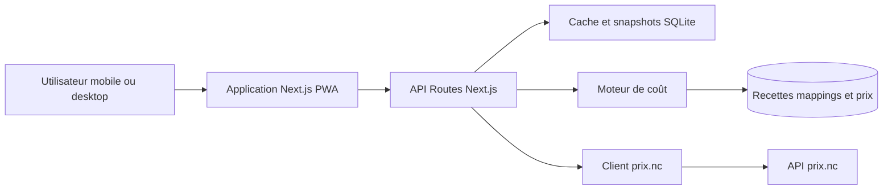

# Plan – Application de comparaison de prix entre supermarchés à Nouméa

## 1. Objectif

Permettre à un utilisateur de :

1. Choisir une recette et le nombre de portions.
2. Sélectionner un ou deux supermarchés de Nouméa.
3. Obtenir le coût réel de la recette dans chaque magasin.
4. Voir le panier le moins cher, y compris la répartition optimisée des ingrédients entre deux magasins.
5. Identifier les ingrédients indisponibles ou les économies réalisées.

Les prix et les produits proviennent de l'API prix.nc. Les recettes et les correspondances ingrédient → produit sont gérées par l'application.

## 2. Décisions proposées, modifiables

| Sujet | Décision proposée | Raison |
|---|---|---|
| Plateforme | Application web responsive installable en PWA | Fonctionne sur mobile en magasin, sans publier sur les stores, une seule base de code |
| Devise | XPF, affichage français Nouvelle-Calédonie | Contexte local, pas de décimales |
| Magasins | Sélection de 1 ou 2 magasins maximum | Répond au besoin exprimé et simplifie l'optimisation |
| Coût d'une recette | Afficher le coût d'achat en packs entiers et le coût consommé au prorata | Un pack de 1 kg acheté pour 200 g coûte le prix du pack, mais le reste a une valeur |
| Deux magasins | Afficher deux vues : panier complet dans chaque magasin et panier optimisé réparti entre les deux | Le prix le plus bas peut signifier magasin le moins cher ou répartition optimale |
| Recettes | Recettes internes créées ou pré-remplies dans l'application | L'API prix.nc sert aux produits et aux prix, pas aux recettes |
| Correspondance ingrédients | Mapping manuel validé, avec suggestions automatiques | Les recettes utilisent des ingrédients génériques, les magasins vendent des produits précis |
| Persistance | SQLite en local via le module natif `node:sqlite` | Aucune dépendance native à compiler, migration possible vers PostgreSQL ou Turso |
| Authentification | Aucun compte utilisateur dans le MVP | Réduit la complexité, les recettes restent locales |
| Accès API | Proxy serveur uniquement, clé jamais exposée au navigateur | Sécurité et contournement CORS |

## 3. Architecture



Principes :

- Le frontend ne parle jamais directement à prix.nc.
- Le backend cache les réponses, normalise les données et protège la clé API.
- Le moteur de coût est isolé et testable sans réseau.
- L'adaptateur prix.nc est remplaçable par des fixtures si l'API est indisponible.

## 4. Découverte de l'API prix.nc

L'URL Swagger fournie est `https://prix.nc/api/v1/swagger-ui/index.html`. La spec OpenAPI a été récupérée depuis `/api/v1/v3/api-docs` et stockée dans `docs/openapi.json`. L'API est publique, sans `securityScheme` déclaré au moment de l'implémentation ; le client prévoit néanmoins une clé optionnelle.

À documenter avant tout développement :

- Schéma d'authentification réel : clé en header, Bearer token, query param ou accès public.
- Endpoints disponibles : magasins, produits, catégories, prix, promotions, pagination.
- Format des prix : prix TTC, prix promotionnel, unité de vente, poids ou volume du pack.
- Identifiants stables : identifiant magasin, identifiant produit, EAN.
- Fréquence de mise à jour et éventuelles limites de débit.
- Conditions d'utilisation et attribution obligatoire.

Si la spec ou la clé n'est pas accessible, créer des fixtures locales réalistes et conserver le même contrat d'adaptateur. Le reste de l'application ne doit pas être bloqué.

## 5. Modèle de données

| Table | Rôle | Champs principaux |
|---|---|---|
| `stores` | Magasins de Nouméa | `id`, `prixnc_id`, `name`, `brand`, `address`, `city`, `latitude`, `longitude` |
| `products` | Produits normalisés | `id`, `prixnc_id`, `ean`, `name`, `brand`, `category`, `pack_size`, `pack_unit`, `image_url` |
| `product_prices` | Prix observés par magasin | `id`, `product_id`, `store_id`, `price_xpf`, `promo_price_xpf`, `promo_ends_at`, `unit_price_xpf`, `unit_price_unit`, `observed_at` |
| `canonical_ingredients` | Ingrédients de recettes | `id`, `name`, `category`, `default_unit` |
| `recipes` | Recettes | `id`, `name`, `description`, `base_servings`, `prep_minutes`, `created_at` |
| `recipe_ingredients` | Lignes d'une recette | `id`, `recipe_id`, `canonical_ingredient_id`, `label`, `quantity`, `unit`, `optional` |
| `ingredient_products` | Mapping ingrédient → produit | `id`, `canonical_ingredient_id`, `product_id`, `store_id` nullable, `priority`, `validated` |
| `sync_runs` | Traçabilité des synchronisations | `id`, `started_at`, `finished_at`, `status`, `message` |

Contraintes importantes :

- Un produit peut avoir plusieurs prix, un par magasin et par date d'observation.
- Le prix courant est le dernier prix observé pour un couple produit/magasin.
- Le prix promotionnel est utilisé seulement s'il est actif à la date de comparaison.
- Les unités sont normalisées en g, ml ou unité avant tout calcul.

## 6. Moteur de coût

### 6.1 Normalisation

- Convertir les quantités de la recette en unité de base : g, ml ou unité.
- Convertir la taille du pack dans la même unité.
- Refuser ou signaler les conversions impossibles, par exemple grammes vers unités.

### 6.2 Coût d'un ingrédient

Pour chaque ingrédient et chaque magasin :

1. Trouver les produits candidats via le mapping validé.
2. Filtrer les produits disponibles dans le magasin.
3. Choisir l'offre la moins chère qui couvre la quantité nécessaire.
4. Calculer le nombre de packs : `ceil(quantite_necessaire / taille_pack)`.
5. Calculer le coût d'achat : `nombre_packs * prix_pack`.
6. Calculer le coût consommé : `quantite_necessaire / taille_pack * prix_pack`.

Si aucun produit n'est disponible, l'ingrédient est marqué manquant et le total est signalé comme incomplet.

### 6.3 Comparaison à un magasin

- Sommer les coûts d'achat des ingrédients pour le magasin A.
- Sommer les coûts d'achat des ingrédients pour le magasin B.
- Afficher le magasin le moins cher et l'économie par rapport à l'autre.

### 6.4 Panier optimisé sur deux magasins

- Pour chaque ingrédient, choisir l'offre la moins chère parmi les deux magasins.
- Sommer les meilleurs prix.
- Afficher la répartition : quels ingrédients acheter dans quel magasin.
- Afficher l'économie par rapport au meilleur magasin unique.
- Signaler le nombre d'articles par magasin pour évaluer l'effort pratique.

### 6.5 Cas particuliers

- Ingrédient optionnel absent : ne pas bloquer le calcul, l'indiquer.
- Produit en promotion : afficher le prix normal, le prix promo et la date de fin.
- Prix obsolète : badge de fraîcheur et possibilité de rafraîchir.
- Portions : multiplier les quantités par `portions_demandees / portions_de_base`.
- Table de correspondance vide : proposer une recherche produit et enregistrer le mapping.

## 7. API interne

| Méthode | Route | Usage |
|---|---|---|
| GET | `/api/stores` | Liste des magasins disponibles |
| GET | `/api/products?q=...&storeId=...` | Recherche de produits et prix |
| GET | `/api/products/:id/prices` | Prix d'un produit dans tous les magasins |
| GET | `/api/ingredients?q=...` | Recherche d'ingrédients canoniques |
| GET | `/api/recipes` | Liste des recettes |
| POST | `/api/recipes` | Création d'une recette |
| GET | `/api/recipes/:id` | Détail d'une recette |
| PUT | `/api/recipes/:id` | Modification d'une recette |
| DELETE | `/api/recipes/:id` | Suppression d'une recette |
| POST | `/api/recipes/:id/cost` | Calcul du coût pour 1 ou 2 magasins |
| POST | `/api/mappings` | Validation d'un mapping ingrédient → produit |

Exemple de réponse pour le calcul de coût :

```json
{
  "recipeId": "rec_123",
  "servings": 4,
  "selectedStores": ["store_a", "store_b"],
  "singleStore": [
    { "storeId": "store_a", "totalPurchaseXpf": 4850, "totalConsumedXpf": 3120, "missing": [] },
    { "storeId": "store_b", "totalPurchaseXpf": 5120, "totalConsumedXpf": 3280, "missing": [] }
  ],
  "bestSingleStore": { "storeId": "store_a", "savingsXpf": 270 },
  "optimizedSplit": {
    "totalPurchaseXpf": 4410,
    "savingsVsBestSingleXpf": 440,
    "assignments": [
      { "ingredient": "Poulet", "storeId": "store_b", "lineTotalXpf": 1200 },
      { "ingredient": "Riz", "storeId": "store_a", "lineTotalXpf": 450 }
    ]
  },
  "warnings": []
}
```

## 8. Arborescence cible

```text
app/
  page.tsx
  stores/page.tsx
  products/page.tsx
  recipes/page.tsx
  recipes/[id]/page.tsx
  recipes/[id]/edit/page.tsx
  api/stores/route.ts
  api/products/route.ts
  api/products/[id]/prices/route.ts
  api/recipes/route.ts
  api/recipes/[id]/route.ts
  api/recipes/[id]/cost/route.ts
  api/mappings/route.ts
components/
  StoreSelector.tsx
  ProductSearch.tsx
  RecipeEditor.tsx
  CostComparison.tsx
  SplitBasket.tsx
  PriceBadge.tsx
lib/
  prixnc/client.ts
  prixnc/mappers.ts
  pricing/engine.ts
  pricing/units.ts
  pricing/currency.ts
  db/schema.ts
  db/index.ts
  validation/schemas.ts
scripts/
  sync-prices.ts
  seed.ts
tests/
  pricing.test.ts
  units.test.ts
  prixnc-adapter.test.ts
docs/
  openapi.json
```

## 9. Variables d'environnement

```bash
PRIXNC_BASE_URL=https://prix.nc/api/v1
PRIXNC_API_KEY=
PRIXNC_AUTH_HEADER=Authorization
DATABASE_URL=file:./data/app.db
PRICE_CACHE_TTL_MINUTES=720
```

La clé ne doit jamais être préfixée par `NEXT_PUBLIC_` et ne doit jamais être envoyée au navigateur.

## 10. Ordre d'implémentation

Le suivi détaillé est maintenu dans la todo list. Les grandes étapes sont :

1. Découverte et validation de l'API prix.nc.
2. Socle Next.js, TypeScript, Tailwind, SQLite et variables d'environnement.
3. Adaptateur prix.nc, types générés depuis OpenAPI, cache et fixtures.
4. Modèle de données et utilitaires unités/devise.
5. Endpoints internes magasins, produits, recettes et mappings.
6. Moteur de coût et tests unitaires.
7. Interface de sélection des magasins, recherche produits et comparaison.
8. Éditeur de recettes et mapping ingrédients.
9. Recettes de démonstration, finitions PWA et documentation.

## 11. Critères d'acceptation du MVP

- L'utilisateur peut lister les magasins de Nouméa issus de prix.nc.
- L'utilisateur peut sélectionner un ou deux magasins.
- L'utilisateur peut créer une recette avec au moins cinq ingrédients, quantités et unités.
- L'utilisateur peut associer chaque ingrédient à un produit réel avec une recherche et des suggestions.
- Le coût est affiché par magasin, en XPF, avec le détail par ingrédient.
- Le panier optimisé sur deux magasins est affiché avec la répartition et l'économie.
- Les produits manquants et les prix obsolètes sont signalés.
- La clé API n'est jamais visible côté client.
- Les conversions d'unités, les arrondis de packs et l'optimisation sont couverts par des tests.
- L'interface est utilisable sur mobile et installable en PWA.
- Un fichier `README.md` explique l'installation, la configuration de la clé et le lancement.

## 12. Risques et mitigations

| Risque | Impact | Mitigation |
|---|---|---|
| Spec ou authentification prix.nc évolutive | Blocage ou rupture d'intégration | Spec versionnée dans le dépôt, client configurable et clé optionnelle, fixtures locales |
| Couverture produits incomplète | Coûts faux ou incomplets | Signalement des manquants, mapping manuel, choix de produits de substitution |
| Unités et tailles de packs hétérogènes | Calculs erronés | Normalisation stricte, tests, affichage du détail du calcul |
| Limites de débit ou API instable | Lenteur ou erreurs | Cache SQLite, synchronisation planifiée, backoff et messages clairs |
| Correspondance ingrédient/produit imprécise | Résultats peu fiables | Suggestions + validation manuelle + seed de mappings courants |
| Conditions d'utilisation de prix.nc | Risque juridique | Vérifier les CGU, limiter les appels, attribuer la source |
| Prix qui changent souvent | Écart avec la réalité | Afficher la date d'observation et permettre le rafraîchissement |

## 13. Hors périmètre du MVP

- Comptes utilisateurs et synchronisation multi-appareils.
- Historique graphique des prix.
- Plus de deux magasins.
- Optimisation avec coût de déplacement ou minimum d'achat.
- Scan de tickets de caisse.
- Contribution communautaire de prix.
- Application mobile native iOS ou Android.
